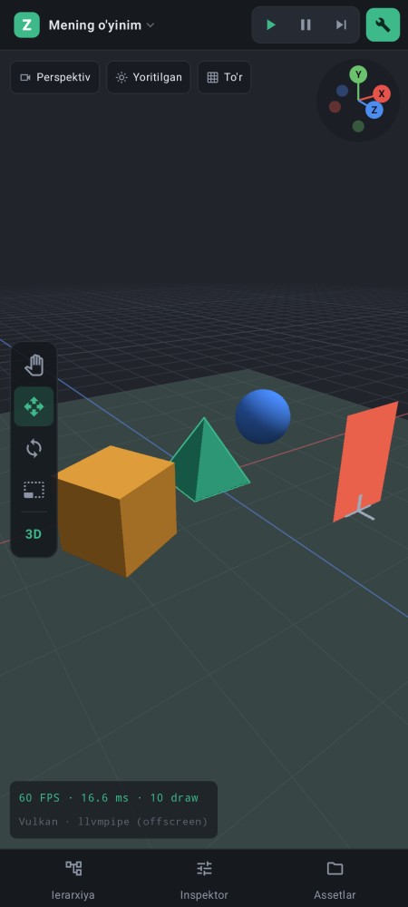
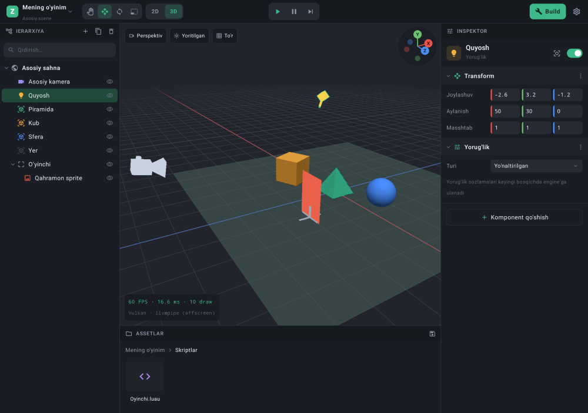
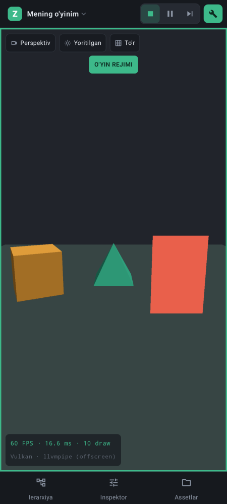
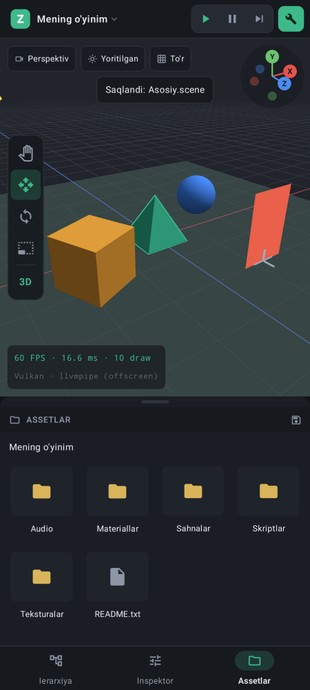
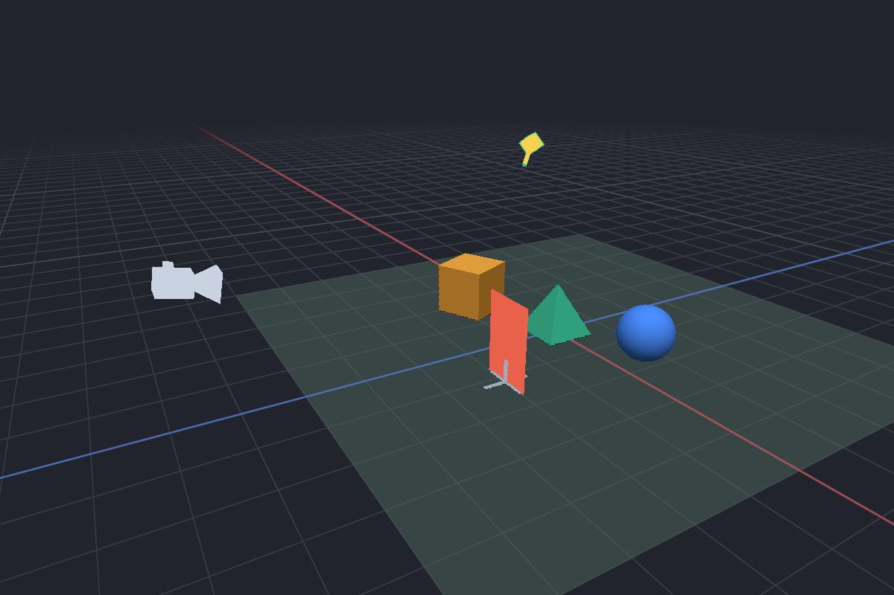

# Zamin Game Engine

Android qurilmaning o'zida **2D va 3D** o'yinlar yaratish, sinash va APK qilib build qilish uchun mobil game engine va editor. Telefon va planshetda ishlaydi.

> Holat: **Bosqich 1 — sahna tizimi** (obyektlar, tanlash, ko'chirish, gizmolar, sahnani saqlash, Play rejimi asosi). To'liq reja: [PLAN.md](PLAN.md)

## Skrinshotlar

| Telefon | Planshet |
|---|---|
|  |  |

| O'yin rejimi | Assetlar | Engine: gizmolar |
|---|---|---|
|  |  |  |

> Skrinshotlar `tools/screenshots.sh` bilan olinadi. Viewport'dagi rasmni engine'ning Vulkan renderer'i offscreen rejimda chizadi (GPU yoki mesa lavapipe'da), editor UI'ni Paparazzi rasmga oladi. Bu haqiqiy qurilmadan olingan skrinshot emas, lekin ikkalasi ham ilovadagi aynan o'sha kod bilan chiziladi.

## Tuzilma

```
engine/                  C++20 engine yadrosi
  include/zamin/         Public headerlar (core, math, scene, rhi)
  src/scene/             Sahna: obyektlar ierarxiyasi (keshlangan dunyo matritsalari), raycast bilan tanlash, gizmolar
  tests/                 Engine unit testlari (GPU'siz)
  src/core/              Log, vaqt, Engine (render oqimi)
  src/rhi/vulkan/        Vulkan renderer (pre-rotation, depth, swapchain)
  src/platform/android/  JNI ko'prik
  shaders/               GLSL shaderlar (build vaqtida SPIR-V ga)
android/editor/          Kotlin + Jetpack Compose editor ilovasi
tools/snapshot/          Engine kadrini PNG ga chizuvchi desktop vosita
tools/screenshots.sh     Barcha skrinshotlarni yangilash
docs/screenshots/        Oxirgi skrinshotlar
```

## Talablar

- Android 10+ (API 29), Vulkan 1.1 qo'llab-quvvatlaydigan 64-bit qurilma
- Build uchun: JDK 17+, Android SDK 35, NDK `27.2.12479018`, CMake `3.22.1`

## Build

```bash
echo "sdk.dir=/path/to/android-sdk" > local.properties
./gradlew :editor:assembleRelease
# APK: android/editor/build/outputs/apk/release/editor-release.apk (~4 MB)
```

Testlar:

```bash
# Engine (C++, GPU kerak emas)
cmake -S engine/tests -B build/tests && cmake --build build/tests && ./build/tests/zamin_tests
# Editor (Kotlin unit testlari + Paparazzi skrinshot tekshiruvi)
./gradlew :editor:testDebugUnitTest :editor:verifyPaparazziDebug
```

Skrinshotlarni yangilash (Linux, Vulkan drayveri kerak — masalan `mesa-vulkan-drivers`):

```bash
./tools/screenshots.sh
```

Har bir `main`ga push qilinganda GitHub Actions APK yasaydi. Uni Actions sahifasidagi **Artifacts** bo'limidan yuklab olish mumkin.

## Hozir nima ishlaydi

- **Sahna:** kub, sfera, piramida, tekislik va 2D sprite (rangli kvadrat). Obyektlar ichma-ich (ota-bola) joylasha oladi.
- **Gizmolar:** yorug'lik (olmos va nur yo'nalishi), kamera va bo'sh obyektlar viewport'da belgi bilan ko'rinadi va ularni teginib tanlash mumkin. Belgilar kamera masofasiga qarab kattalashadi.
- **Loyiha fayllari:** loyiha ilovaning ichki xotirasida (`Sahnalar`, `Materiallar`, `Skriptlar`, `Teksturalar`, `Audio`). Sahna `Sahnalar/Asosiy.scene` ga JSON ko'rinishida saqlanadi (Assetlar panelidagi tugma yoki ilova fonga o'tganda avtomatik). Assetlar paneli haqiqiy fayllarni ko'rsatadi: papkaga kirish, yo'l bo'ylab qaytish, `.scene` faylini ikki marta teginib ochish, tizim fayl tanlagichi orqali import.
- **O'yin rejimi (Play):** sahna holati saqlab qo'yiladi, viewport sahnadagi "Asosiy kamera" ko'rinishiga o'tadi (to'r, gizmo va tanlov ko'rinmaydi, editor kamerasi qotadi). To'xtatilganda sahna aynan avvalgi holatiga qaytadi. Skript va fizika keyingi bosqichda ulanadi.
- **Ierarxiya:** "+" orqali obyekt qo'shish, nusxa olish, o'chirish, ko'rinishni yoqish/o'chirish, qidiruv.
- **Inspektor:** joylashuv, aylanish, masshtab, mesh turi va rang. O'zgarishlar darhol 3D sahnada ko'rinadi.
- **Viewport boshqaruvi:**
  - teginish — obyektni tanlash (yashil chegara bilan ko'rsatiladi), bo'sh joyga teginish — tanlovni bekor qilish;
  - tanlangan obyekt ustidan surish — tanlangan asbob bilan ishlaydi: ko'chirish (yer tekisligi bo'ylab), aylantirish (gorizontal surish — vertikal o'q atrofida, vertikal surish — kameraning o'ng o'qi atrofida; 2D da ekran tekisligida), masshtab;
  - bo'sh joydan surish — kamerani aylantirish; ikki barmoq — surish va yaqinlashtirish;
  - ikki marta teginish yoki Inspektordagi fokus tugmasi — kamerani obyektga qaratish.
- **2D/3D:** 2D rejimda ortografik kamera XY tekisligiga qaraydi, to'r ham XY ga o'tadi.
- FPS, kadr vaqti, haqiqiy draw call soni (tanlov chegarasi va to'r bilan) va GPU nomi ko'rsatiladi.
- Planshetda yonma-yon panellar (Ierarxiya / Inspektor / Assetlar), telefonda pastki navigatsiya.
