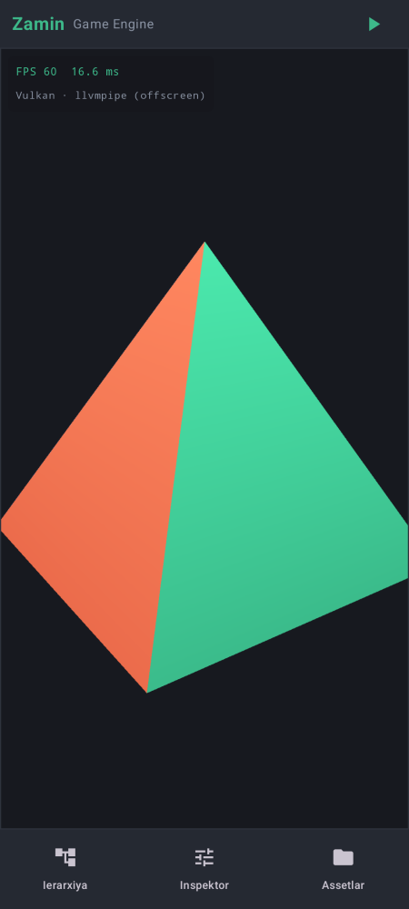
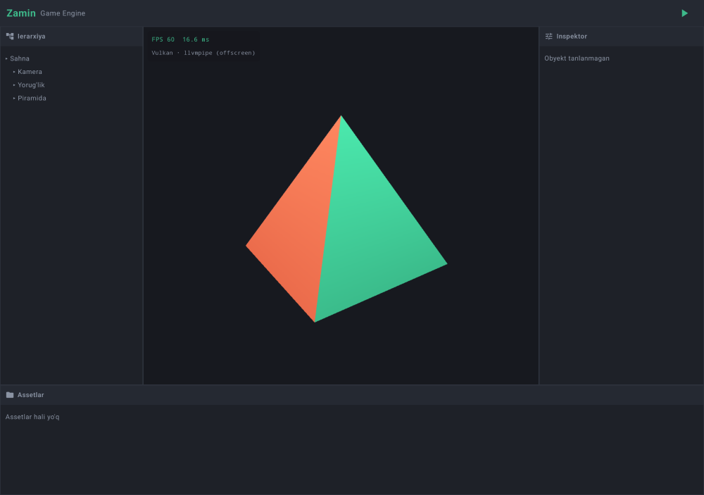

# Zamin Game Engine

Android qurilmaning o'zida **2D va 3D** o'yinlar yaratish, sinash va APK qilib build qilish uchun mobil game engine va editor. Telefon va planshetda ishlaydi.

> Holat: **Bosqich 0 — poydevor** (Vulkan viewport + moslashuvchan editor oynasi). To'liq reja: [PLAN.md](PLAN.md)

## Skrinshotlar

| Telefon | Planshet |
|---|---|
|  |  |

> Skrinshotlar `tools/screenshots.sh` bilan olinadi. Viewport'dagi rasmni engine'ning Vulkan renderer'i offscreen rejimda chizadi (GPU yoki mesa lavapipe'da), editor UI'ni Paparazzi rasmga oladi. Bu haqiqiy qurilmadan olingan skrinshot emas, lekin ikkalasi ham ilovadagi aynan o'sha kod bilan chiziladi.

## Tuzilma

```
engine/                  C++20 engine yadrosi
  include/zamin/         Public headerlar (core, rhi)
  src/core/              Log, vaqt, Engine (render oqimi)
  src/rhi/vulkan/        Vulkan renderer (pre-rotation, depth, swapchain)
  src/platform/android/  JNI ko'prik
  shaders/               GLSL shaderlar (build vaqtida SPIR-V ga)
android/editor/          Kotlin + Jetpack Compose editor ilovasi
tools/snapshot/          Engine kadrini PNG ga chizuvchi desktop vosita
tools/screenshots.sh     Barcha skrinshotlarni yangilash
docs/screenshots/        Oxirgi skrinshotlar
```

## Talablar

- Android 10+ (API 29), Vulkan 1.1 qo'llab-quvvatlaydigan 64-bit qurilma
- Build uchun: JDK 17+, Android SDK 35, NDK `27.2.12479018`, CMake `3.22.1`

## Build

```bash
echo "sdk.dir=/path/to/android-sdk" > local.properties
./gradlew :editor:assembleRelease
# APK: android/editor/build/outputs/apk/release/editor-release.apk (~4 MB)
```

Skrinshotlarni yangilash (Linux, Vulkan drayveri kerak — masalan `mesa-vulkan-drivers`):

```bash
./tools/screenshots.sh
```

Har bir `main`ga push qilinganda GitHub Actions APK yasaydi. Uni Actions sahifasidagi **Artifacts** bo'limidan yuklab olish mumkin.

## Hozir nima ishlaydi

- Vulkan bilan 3D piramida chiziladi. Barmoq bilan surib aylantirish mumkin.
- FPS, kadr vaqti va GPU nomi ko'rsatiladi.
- Planshetda yonma-yon panellar (Ierarxiya / Inspektor / Assetlar), telefonda pastki navigatsiya.
